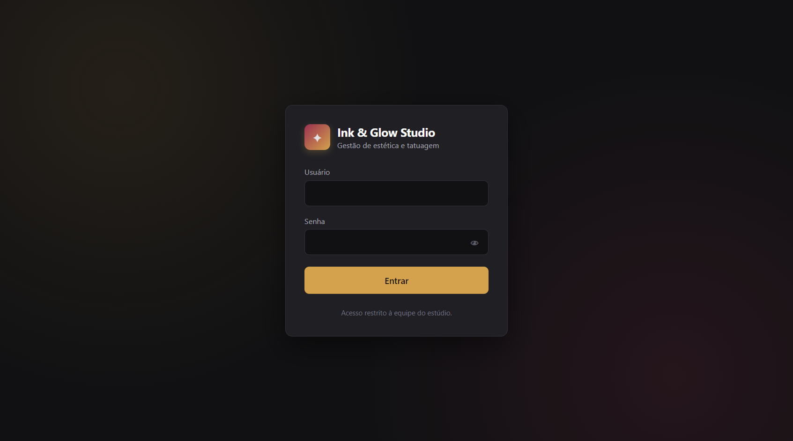
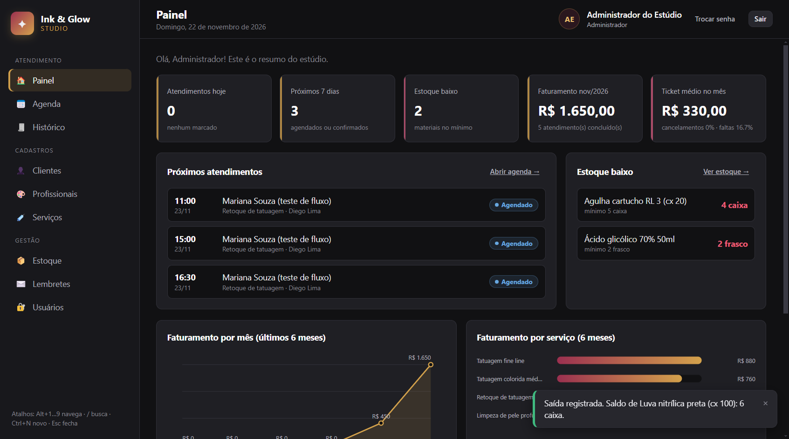
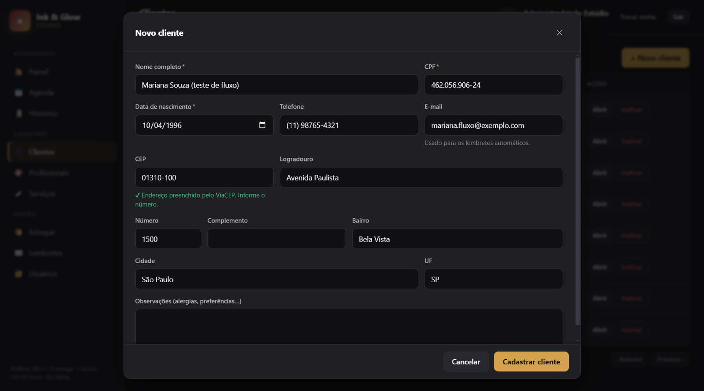
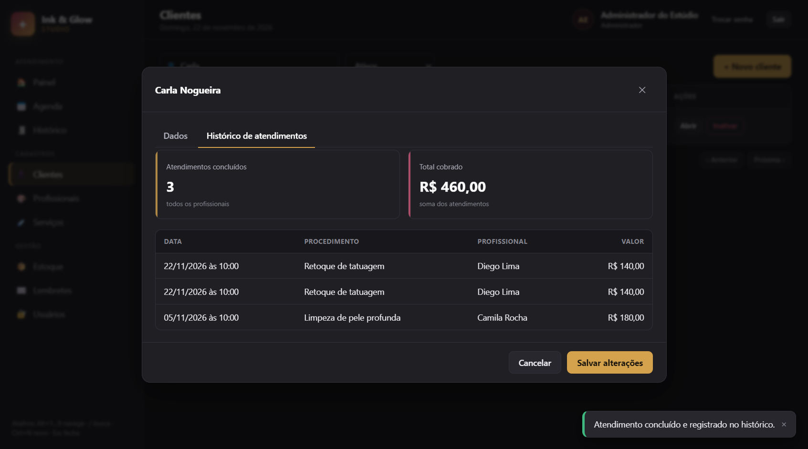
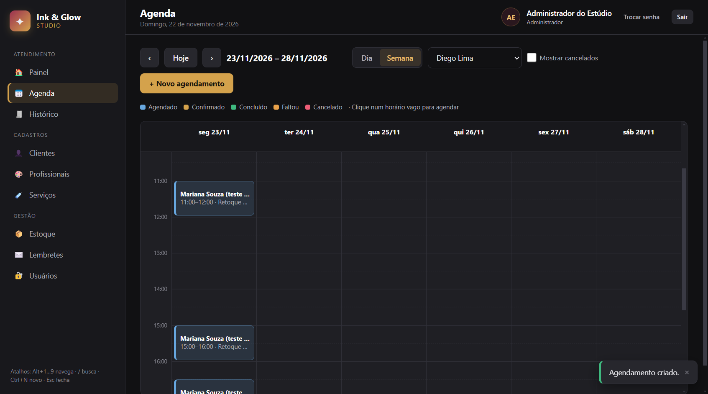
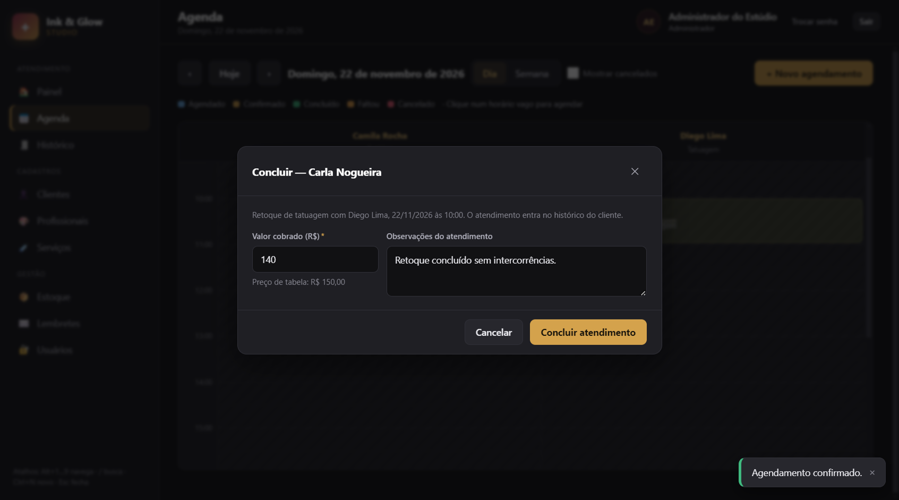
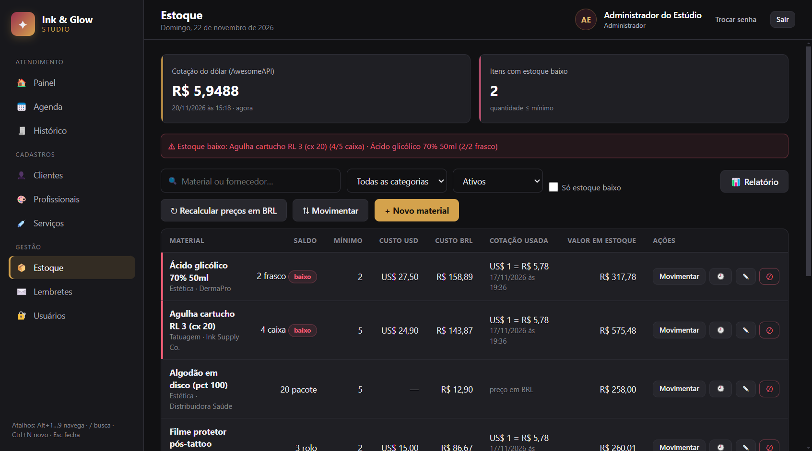
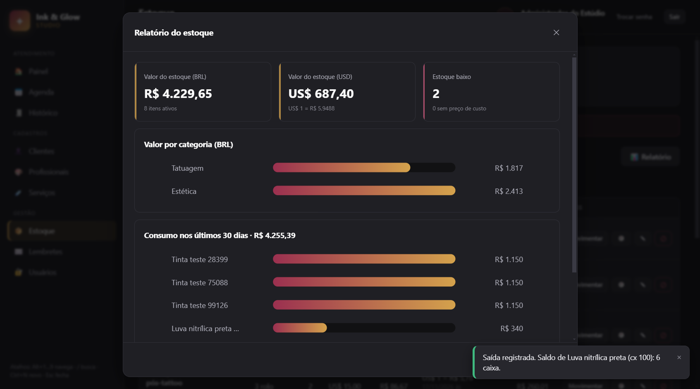
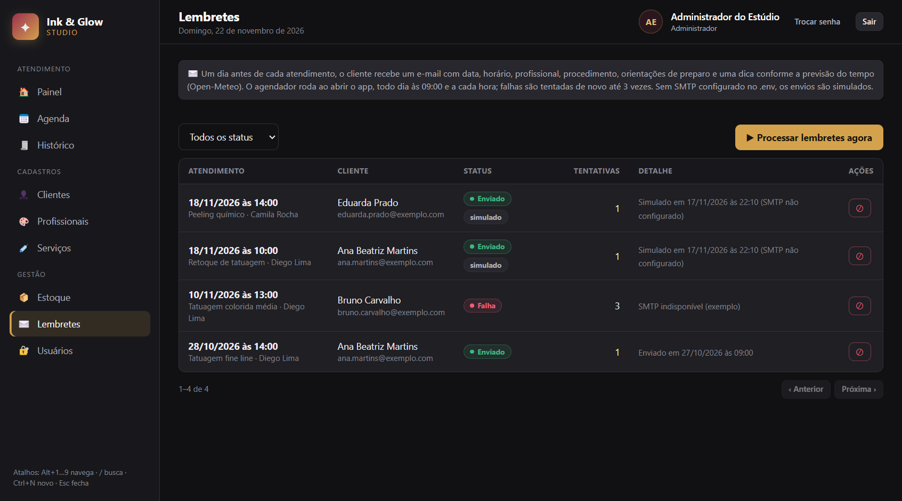
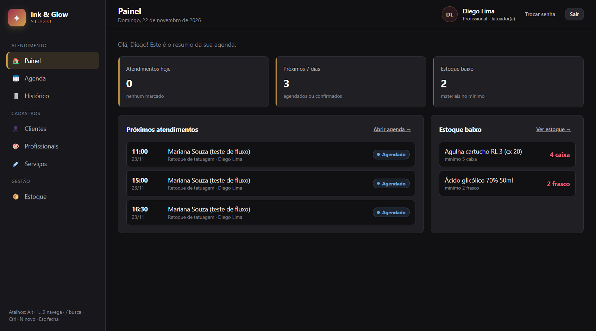

# Ink & Glow Studio 🎨✨
> Aplicação desktop em **Electron**, **TypeScript** (POO) e **MySQL** para gestão de estúdio de estética e tatuagem: clientes, profissionais, serviços, agenda, histórico de atendimentos, estoque e lembretes automáticos.

Projeto desenvolvido para a disciplina **DAD (Desenvolvimento de Aplicações Desktop)** sob orientação do professor **willcotil**.
O escopo oficial está em [docs/CONTEXTO.md](docs/CONTEXTO.md).

---

## 📌 Status do projeto

| Parte | Módulo | Branch / PR | Status |
| :---: | :--- | :--- | :---: |
| 0 | Alinhamento da base ao escopo oficial | `feat/alinhamento-base` (#1) | ✅ |
| 1 | Configuração inicial e infraestrutura Electron | commits iniciais na `main` | ✅ |
| 2 | Banco de dados MySQL (8 tabelas) | `feat/banco-de-dados` (#2) | ✅ |
| 3 | Cadastros (clientes, serviços, profissionais) + ViaCEP | `feat/cadastros` (#3) | ✅ |
| 4 | Login, sessão e permissões (RBAC) | `feat/autenticacao` (#4) | ✅ |
| 5 | Agenda, histórico e estatísticas + feriados (BrasilAPI) | `feat/agenda-historico` (#5) | ✅ |
| 6 | Lembretes por e-mail + clima (Open-Meteo) | `feat/lembretes` (#6) | ✅ |
| 7 | Estoque com cotação USD→BRL (AwesomeAPI) | `feat/estoque` (#8) | ✅ |
| 8 | Interface do usuário (todas as telas) | `feat/interface` | ✅ |

O app está completo: camada de negócio (entidades, repositories, services, IPC e preload) e **interface com todas as telas**, testadas de ponta a ponta pela própria interface (ver [Interface](#️-interface) e [Como testar](#-como-testar)).

---

## ✅ Funcionalidades implementadas

- **Clientes**: cadastro com validação de CPF, e-mail e telefone, endereço preenchido pelo **CEP (ViaCEP)**, busca por nome ou CPF com paginação, aviso para menor de 18 anos, exclusão lógica.
- **Serviços**: catálogo com categoria (tatuagem/estética), duração e preço; não pode ser inativado com agendamento futuro.
- **Profissionais**: usuários com especialidade (tatuador/esteticista), vínculo N:N com os serviços que realizam (compatível com a especialidade).
- **Usuários e login**: senhas com **bcryptjs**, bloqueio de 15 min após 5 tentativas erradas, mensagens genéricas, troca e reset de senha, sessão que expira após 30 min sem uso.
- **Permissões (RBAC)**: perfis ADMIN, RECEPCAO e PROFISSIONAL, checados no processo main antes de cada ação ([matriz](docs/permissoes.md)).
- **Agenda**: criar, remarcar, confirmar, cancelar, concluir e marcar falta, com máquina de estados, bloqueio de conflito de horário, horário de funcionamento configurável e aviso de **feriado nacional (BrasilAPI)**. O profissional só vê e altera a própria agenda.
- **Histórico**: atendimentos concluídos por cliente, profissional ou período, com total cobrado.
- **Estatísticas**: atendimentos e faturamento por mês, serviço e profissional, ticket médio, taxa de cancelamento/falta, clientes novos × recorrentes.
- **Estoque**: materiais com custo em **USD e BRL** (cotação do dia pela **AwesomeAPI**, com cache de 15 min e último valor salvo como reserva), entradas, saídas e ajustes de inventário em transação, bloqueio de saída maior que o saldo, estorno, alerta de estoque baixo, relatório de valor e consumo por período.
- **Lembretes**: e-mail um dia antes do agendamento (Nodemailer) com orientações de preparo e **dica de clima (Open-Meteo)**; agendador **node-cron** (ao abrir o app, diariamente às 09:00 e a cada hora); até 3 tentativas; reenvio manual; **modo simulação** quando não há SMTP configurado.

## 🛠️ Tecnologias

- **Electron** (processos Main, Preload e Renderer isolados, `contextIsolation`, `sandbox`)
- **TypeScript** estrito, orientado a objetos (sem `.js` escrito à mão)
- **MySQL** com **mysql2** (prepared statements)
- **bcryptjs** (hash de senhas)
- **dotenv** (configuração via `.env`)
- **Nodemailer** (envio de lembretes por e-mail via SMTP)
- **node-cron** (agendador de lembretes)
- **ts-node**, **concurrently**, **rimraf**, **ESLint** (ferramentas de desenvolvimento)

**Interface sem frameworks:** HTML, CSS e TypeScript puro (módulos ES), com componentes próprios em classes — `Modal`, `DataTable`, `FormField`, `Toast`, `Sidebar`, `Abas` e gráficos em SVG. A escolha evita dependências pesadas no renderer e deixa visível a orientação a objetos pedida na disciplina.

## 🖥️ Interface

Tema escuro (grafite com destaques em dourado e vinho). O menu mostra só as telas que o perfil logado pode usar, e toda ação é conferida de novo no processo main.

| Login | Painel (ADMIN) |
| :---: | :---: |
|  |  |
| **Cliente com endereço pelo CEP (ViaCEP)** | **Histórico do cliente** |
|  |  |
| **Agenda — visão semanal** | **Concluir atendimento** |
|  |  |
| **Estoque — USD e BRL com a cotação** | **Relatório do estoque** |
|  |  |
| **Lembretes** | **Perfil tatuador (menu reduzido)** |
|  |  |

**Telas:** Painel · Agenda (dia e semana) · Histórico · Clientes · Profissionais · Serviços · Estoque · Lembretes · Usuários.

**Atalhos de teclado:** `Alt+1…9` navega pelo menu · `/` vai para a busca · `Ctrl+N` cria um item na tela atual · `Esc` fecha janelas.

**Acessibilidade:** campos com rótulo e mensagem de erro ligados ao campo, foco visível, foco preso dentro das janelas modais (e devolvido ao fechar), avisos anunciados a leitores de tela e contraste alto no tema escuro.

## 🌐 APIs externas

Todas têm classe tipada, timeout de 5s e fallback (o sistema não trava se a API cair).

| API | Uso no sistema | Classe | Status |
| :--- | :--- | :--- | :---: |
| **ViaCEP** | Preenche o endereço do cliente a partir do CEP. | `ViaCepClient` | ✅ |
| **BrasilAPI** | Aviso de feriado nacional na agenda (cache por ano). | `FeriadosClient` | ✅ |
| **Open-Meteo** | Previsão do tempo para a dica de cuidado no lembrete. | `ClimaClient` | ✅ |
| **AwesomeAPI** | Cotação USD→BRL do preço de custo dos materiais. | `CotacaoClient` | ✅ |

## 🗄️ Banco de dados (8 tabelas)

`usuarios`, `clientes`, `servicos`, `profissional_servicos` (N:N), `agendamentos`, `materiais`, `movimentacoes_estoque`, `lembretes` — com chaves estrangeiras, índices, `created_at/updated_at` e exclusão lógica (`ativo`).
Diagrama ER e descrição de cada tabela: [docs/modelo-banco.md](docs/modelo-banco.md).

## 👥 Perfis de acesso

- **ADMIN** — acesso total.
- **RECEPCAO** — clientes, agenda de todos os profissionais, histórico, reenvio de lembretes e estoque (leitura).
- **PROFISSIONAL** (`TATUADOR` ou `ESTETICISTA`) — própria agenda, conclusão dos próprios atendimentos, histórico dos seus clientes, consumo de material.

---

## 🚀 Como executar

### 1. Pré-requisitos
- **Node.js** 18 ou superior
- **MySQL** 8.0.16+ (local ou remoto, ex.: servidor da faculdade)

### 2. Instalação
```bash
npm install
```

### 3. Configuração do ambiente
```bash
cp .env.example .env
```
*(No Windows PowerShell: `Copy-Item .env.example .env`)*

Preencha no `.env`:
- **Banco**: `DB_HOST`, `DB_PORT`, `DB_USER`, `DB_PASSWORD`, `DB_NAME` (em servidor compartilhado, o banco costuma ter o mesmo nome do usuário).
- **E-mail (opcional)**: `SMTP_HOST`, `SMTP_PORT`, `SMTP_USER`, `SMTP_PASS`, `SMTP_FROM`. Sem eles, os lembretes rodam em **modo simulação**.
- **Estúdio**: `STUDIO_NOME`, `STUDIO_ENDERECO`, `CLIMA_LATITUDE`, `CLIMA_LONGITUDE`, horário de funcionamento e de lembretes (todos têm padrão).

### 4. Banco de dados
```bash
npm run db:init
```
Cria as 8 tabelas e insere os dados de exemplo (se o banco estiver vazio). Para recriar do zero (apaga **somente** as 8 tabelas do projeto):
```bash
npm run db:init -- --reset
```
Conferir conexão e quantidade de linhas por tabela:
```bash
npm run db:check
```

### 5. Executar
```bash
npm start
```
Modo desenvolvimento (recompila ao salvar):
```bash
npm run dev
```

### Usuários de teste (seed — apenas desenvolvimento)

| Usuário | Senha | Perfil |
| :--- | :--- | :--- |
| `admin` | `admin123` | ADMIN |
| `recepcao` | `recepcao123` | RECEPCAO |
| `tatuador` | `tatuador123` | PROFISSIONAL (tatuador) |
| `esteticista` | `esteticista123` | PROFISSIONAL (esteticista) |

---

## 🧪 Como testar

### Pela interface

Rode `npm start`, entre com um dos usuários de teste e siga o fluxo principal:
**cliente com CEP → agendamento (avisos de conflito e feriado) → confirmar → concluir com valor → histórico do cliente → saída de material no estoque.**
Depois entre como `tatuador` para ver o menu reduzido, a agenda só dele e o estoque limitado a "registrar consumo".

> Esse fluxo foi executado de ponta a ponta pela própria interface (clicando e preenchendo as telas do app real) e todas as etapas passaram; as capturas acima são dessa execução.

### Scripts de teste (contra o banco do `.env`)

Cada script mostra ✔/✖ por item e, no fim, inativa (exclusão lógica) o que criou. Use `--manter` para manter os registros.

| Comando | O que demonstra |
| :--- | :--- |
| `npx ts-node scripts/testCadastros.ts` | CEP real (ViaCEP), cliente, serviço, vínculo com profissional, CPF duplicado/inválido, regras de inativação. |
| `npx ts-node scripts/testAgenda.ts` | Criação, conflito de horário, horário de funcionamento, feriado (aviso + confirmação), máquina de estados, conclusão, histórico e estatísticas. |
| `npx ts-node scripts/testLembretes.ts` | Lembrete em modo simulação com clima real, cliente sem e-mail, 3 tentativas com falha, sem duplicidade, reenvio manual. |
| `npx ts-node scripts/testEstoque.ts` | Preço em USD convertido pela cotação real, entrada, saída, saldo insuficiente, ajuste, alerta de estoque baixo, regras do profissional, estorno e relatórios. |

### Pela API do preload (console do DevTools)

Com o app aberto e logado, abra **View → Toggle Developer Tools** e use a API exposta pelo preload (respostas no formato `{ ok, data, error }`, com as permissões do usuário logado):

```js
await api.clientes.listar({ termo: 'Ana' })
await api.clientes.buscarCep('01310-100')
await api.agenda.listar({ dataInicio: '2026-11-01', dataFim: '2026-12-31' })
await api.agenda.verificarFeriado('2026-12-25')
await api.historico.porCliente({ clienteId: 1 })
await api.estatisticas.resumo({ dataInicio: '2026-01-01', dataFim: '2026-12-31' })
await api.lembretes.rodarAgora()
```

## 📜 Scripts npm

| Script | Descrição |
| :--- | :--- |
| `npm start` | Compila e abre o app. |
| `npm run dev` | Compila em modo watch e abre o app. |
| `npm run build` | Limpa `dist/` e compila main, preload e renderer. |
| `npm run db:init` | Cria tabelas e seed (`-- --reset` recria do zero). |
| `npm run db:check` | Versão do MySQL e contagem de linhas por tabela. |

---

## 📁 Estrutura

```
src/
  main/
    main.ts              # janela, registro de IPC e agendador de lembretes
    core/
      database/          # Database (Singleton, pool mysql2) e BaseRepository
      entities/          # Cliente, Servico, Profissional, Usuario, Agendamento, Lembrete, Material, ...
      repositories/      # acesso ao MySQL com SQL parametrizado
      services/          # regras de negócio (cadastros, auth, agenda, histórico, estatísticas, lembretes, estoque)
      security/          # SessionManager, Permissao (RBAC), AuthorizationService, IpcGuard
      validators/        # CPF, e-mail, telefone, CEP, data de nascimento
    integrations/        # ViaCepClient, FeriadosClient, ClimaClient, CotacaoClient
    ipc/                 # handlers por módulo e containers de dependências
  preload/               # contextBridge + API tipada (window.api)
  renderer/
    index.html, app.ts   # shell: menu por perfil, roteador (#/rota) e atalhos
    login/               # tela de login
    core/                # Api (ponte com window.api), Sessao, formatação, utilitários de DOM
    components/          # Modal, DataTable, FormField, Toast, Sidebar, Abas, Grafico (SVG)
    views/               # uma classe por tela (Dashboard, Agenda, Clientes, Estoque, ...)
    styles/              # tema, componentes, layout e agenda
  shared/                # tipos e DTOs compartilhados (main ⇄ renderer)
database/                # schema.sql e seed.sql
scripts/                 # initDb, checkDb, gerarHashSenha e testes manuais
docs/                    # documentação do projeto
```

## 📋 Documentação

- [Contexto e arquitetura (fonte oficial)](docs/CONTEXTO.md)
- [Checklist de requisitos](docs/CHECKLIST_REQUISITOS.md)
- [Modelo do banco de dados](docs/modelo-banco.md)
- [Permissões por perfil](docs/permissoes.md)
- [Decisões de segurança](docs/SEGURANCA.md)
- [Especificação do professor (PDF)](docs/requisitos.pdf)

---

## 🕓 Histórico de desenvolvimento

Commits agrupados por parte, em ordem cronológica (padrão `tipo(escopo): descrição`).

<details>
<summary><strong>Parte 1 — Configuração inicial</strong> · marimorelli449 · 03/11/2026</summary>

| Commit | Descrição |
| :--- | :--- |
| `063f15b` | chore: inicializar repositorio git e configurar gitignore |
| `dc11426` | docs: adicionar contexto do projeto e checklist de requisitos |
| `69d3e9b` | build: configurar package.json com electron typescript e dependencias |
| `c8ee76e` | config: configurar tsconfig para main e renderer com strict mode |
| `e8c11b4` | chore: criar estrutura inicial de pastas com gitkeep |
| `552200d` | feat: implementar janela electron com preload seguro e tela inicial |
| `b794f05` | docs: adicionar env example e readme com instrucoes de execucao |
| `de044b8` | build: adicionar package-lock e ajustar resolucao de tipos no renderer |
</details>

<details>
<summary><strong>Parte 0 — Alinhamento da base</strong> · EnricoSerpeloni · PR #1</summary>

| Commit | Descrição |
| :--- | :--- |
| `e32c429` | docs(contexto): alinha CONTEXTO.md ao escopo oficial do grupo |
| `7b1abea` | docs(checklist): atualiza requisitos para 8 tabelas, 4 APIs e perfis oficiais |
| `d7bc3f3` | chore(docs): remove requisitos.pdf duplicado da raiz |
| `c785acb` | build(deps): adiciona node-cron, nodemailer, ts-node e scripts dev/db |
| `d88cfa3` | chore(env): adiciona variaveis de SMTP, clima e dados do estudio ao .env.example |
| `56917b9` | feat(shared): cria pastas da arquitetura e tipos compartilhados |
| `4c9f93e` | docs(readme): ajusta tecnologias, tabelas e APIs ao escopo oficial |
| `9c38512` | docs(claude): adiciona CLAUDE.md com regras tecnicas e de git |
| `1fd4e2b` | build(ts): inclui src/shared na compilacao do processo main |
</details>

<details>
<summary><strong>Parte 2 — Banco de dados</strong> · EnricoSerpeloni · PR #2</summary>

| Commit | Descrição |
| :--- | :--- |
| `105138b` | feat(banco): cria schema.sql com as 8 tabelas relacionadas |
| `ba799a6` | feat(banco): adiciona seed.sql e script para gerar hash bcrypt |
| `09fd3d5` | docs(banco): adiciona modelo-banco.md com diagrama ER em Mermaid |
| `57d3c4c` | feat(banco): implementa Database singleton com pool mysql2 e transacoes |
| `44e0298` | feat(banco): cria BaseRepository generico com CRUD e exclusao logica |
| `151817f` | feat(banco): adiciona script db:init com opcao --reset |
| `2077c45` | feat(banco): adiciona script db:check com versao e contagem por tabela |
| `a8c7bb8` | docs(banco): documenta uso do db:init em servidor MySQL compartilhado |
</details>

<details>
<summary><strong>Parte 3 — Cadastros + ViaCEP</strong> · VitorMiguelMoreira · PR #3</summary>

| Commit | Descrição |
| :--- | :--- |
| `33507c2` | feat(validators): adiciona validadores de CPF, e-mail, telefone, CEP e nascimento |
| `a29331c` | feat(entidades): cria Cliente, Servico, Profissional, Endereco e DTOs compartilhados |
| `9ad836c` | feat(repositories): adiciona repositories de clientes, servicos e profissionais com busca paginada |
| `ecd8c8a` | feat(services): adiciona services de clientes, servicos e profissionais com regras de negocio |
| `1f38a70` | feat(clientes): adiciona ViaCepClient com timeout e fallback e busca de endereco por CEP |
| `b09de51` | feat(ipc): adiciona handlers de clientes, servicos e profissionais e API tipada no preload |
| `3d72494` | fix(profissionais): melhora mensagem de especialidade incompativel com o servico |
| `d4e1d58` | test(cadastros): adiciona script de teste manual com CEP real, servico e vinculo |
</details>

<details>
<summary><strong>Parte 4 — Login e permissões</strong> · VitorMiguelMoreira · PR #4</summary>

| Commit | Descrição |
| :--- | :--- |
| `157abd7` | feat(usuarios): adiciona entidade Usuario, UsuarioRepository e politica de senha |
| `873b3fc` | feat(seguranca): adiciona SessionManager com expiracao por inatividade e erros de seguranca |
| `809ddd6` | feat(auth): adiciona AuthService com bcrypt, bloqueio apos 5 tentativas e troca de senha |
| `dddf0a1` | feat(seguranca): adiciona permissoes RBAC, AuthorizationService e middleware IpcGuard |
| `719cec3` | feat(auth): adiciona handlers auth e usuarios com UsuarioService e API no preload |
| `f2eaf39` | feat(login): cria tela de login em tema escuro e abre o app por ela |
| `1cf5382` | feat(seguranca): protege handlers de cadastros com IpcGuard e documenta matriz de permissoes |
| `7386f8b` | docs(seguranca): justifica decisoes de seguranca em SEGURANCA.md |
| `0eec85e` | fix(auth): encerra sessao anterior a cada nova tentativa de login |
</details>

<details>
<summary><strong>Parte 5 — Agenda e histórico</strong> · Helen-clara · PR #5</summary>

| Commit | Descrição |
| :--- | :--- |
| `767e030` | feat(agenda): cria entidade Agendamento com maquina de estados e tipos compartilhados |
| `b824bc0` | feat(agenda): adiciona AgendamentoRepository com filtros e verificacao de conflito de horario |
| `aacb5fb` | feat(agenda): adiciona FeriadosClient da BrasilAPI com cache por ano e fallback |
| `dce16ca` | feat(agenda): adiciona AgendamentoService com conflito, horario de funcionamento e aviso de feriado |
| `31514a3` | feat(historico): adiciona HistoricoService por cliente, profissional e periodo com total cobrado |
| `e05193a` | feat(estatisticas): adiciona EstatisticasService com consultas agregadas por mes, servico e profissional |
| `89e1f4b` | feat(agenda): adiciona handlers IPC de agenda, historico e estatisticas com permissoes e preload tipado |
| `36d6fc0` | fix(agenda): corrige dias de funcionamento padrao e valida transicao antes do horario |
| `e5523b6` | test(agenda): adiciona script de teste manual com conflito, feriado e conclusao |
</details>

<details>
<summary><strong>Parte 6 — Lembretes</strong> · Helen-clara · <code>feat/lembretes</code></summary>

| Commit | Descrição |
| :--- | :--- |
| `334e37a` | feat(lembretes): cria entidade Lembrete e LembreteRepository sem duplicidade por agendamento |
| `ffeb3bd` | feat(lembretes): adiciona ClimaClient do Open-Meteo com localizacao do .env e fallback |
| `8817d54` | feat(lembretes): adiciona NotificacaoEmailService com Nodemailer, modo simulacao e template HTML |
| `09afc7e` | feat(lembretes): adiciona LembreteService com dica de clima, registro do envio e ate 3 tentativas |
| `dcb9d42` | feat(lembretes): adiciona AgendadorService com node-cron iniciado e parado junto com o app |
| `5ea87a3` | feat(lembretes): adiciona handlers IPC de listar, reenviar, excluir e rodar agora com preload tipado |
| `ba83867` | fix(lembretes): escreve hoje, amanha ou a data no e-mail conforme o envio |
| `25e71fe` | chore(env): documenta variaveis de lembretes, modo simulacao e horario de funcionamento |
| `e549b3a` | test(lembretes): adiciona script de teste em modo simulacao com falhas e reenvio |
</details>

<details>
<summary><strong>Parte 7 — Estoque USD/BRL</strong> · analivia2303 · PR #8</summary>

| Commit | Descrição |
| :--- | :--- |
| `96dbd3f` | feat(estoque): cria entidades Material e MovimentacaoEstoque com tipos compartilhados |
| `f1eaf4c` | feat(estoque): adiciona CotacaoClient da AwesomeAPI e CotacaoService com cache e fallback |
| `b1a4f17` | feat(estoque): adiciona repositories de materiais e movimentacoes com filtros, estoque baixo e consumo |
| `93069ff` | feat(estoque): adiciona EstoqueService com preco USD/BRL, movimentacoes em transacao, alertas e relatorios |
| `88c4ee9` | feat(estoque): adiciona handlers IPC de estoque com permissoes e preload tipado |
| `475825e` | fix(estoque): consulta consumo em sequencia para nao abrir conexoes simultaneas |
| `fbdc616` | test(estoque): adiciona script de teste com preco em USD, saldo insuficiente e alerta |
</details>

<details>
<summary><strong>Parte 8 — Interface</strong> · analivia2303 · <code>feat/interface</code></summary>

| Commit | Descrição |
| :--- | :--- |
| `c8d51e2` | feat(interface): adiciona componentes base Modal, DataTable, FormField, Toast, Abas e graficos SVG |
| `576b71d` | feat(interface): cria shell principal com menu por perfil, roteador, atalhos e integracao com o login |
| `4386661` | feat(clientes): cria tela de clientes com busca, CEP automatico pelo ViaCEP e historico em aba |
| `83d33ab` | feat(profissionais): cria telas de profissionais e servicos com vinculo por especialidade e ativar/inativar |
| `19b6b1b` | feat(agenda): cria tela de agenda com visao diaria e semanal, cores por status e avisos de conflito e feriado |
| `9ddfaac` | feat(estoque): cria tela de estoque com alerta de estoque baixo, precos USD/BRL, movimentacoes e relatorio |
| `b7d6ff9` | feat(lembretes): cria tela de lembretes com filtro por status, reenvio e processamento manual |
| `31aa486` | feat(dashboard): cria painel inicial com agenda do dia, estoque baixo, faturamento e graficos SVG |
| `97f06df` | feat(interface): adiciona telas de historico por periodo e de usuarios do sistema |
| `c53f8ee` | fix(agenda): rola ate o primeiro atendimento e mostra o profissional do agendamento salvo |
| — | docs(readme): revisão final com capturas de tela, atalhos e histórico das Partes 7 e 8 (este commit) |
</details>
