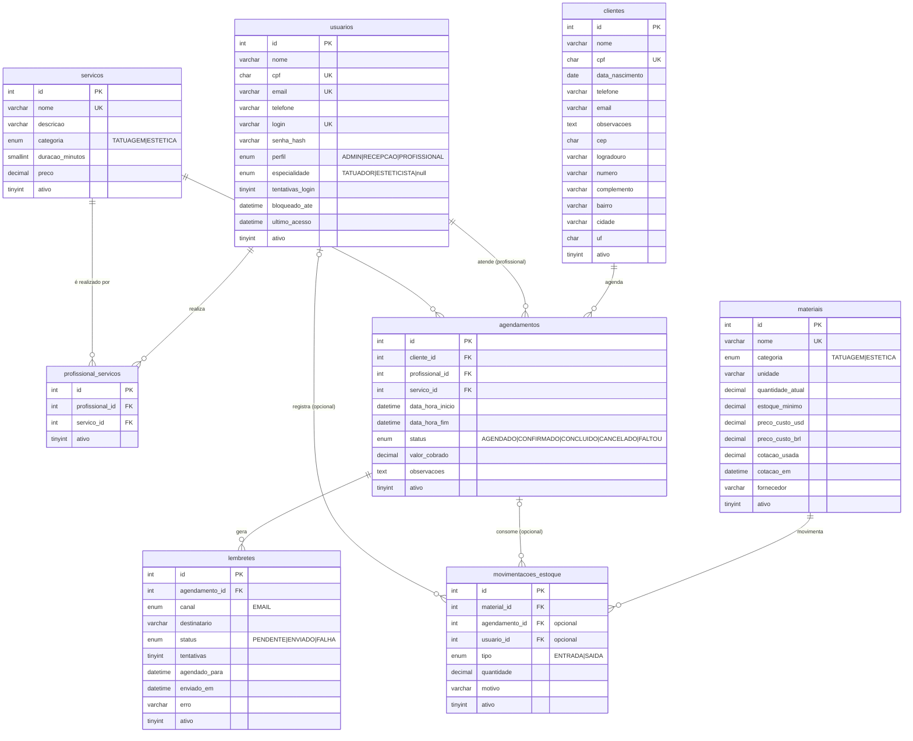

# Modelo do Banco de Dados — Ink & Glow Studio

MySQL 8.0.16+ · InnoDB · `utf8mb4_unicode_ci` · 8 tabelas relacionadas.
Arquivos: [`database/schema.sql`](../database/schema.sql) e [`database/seed.sql`](../database/seed.sql).

Convenções aplicadas em todas as tabelas:
- Chave primária `id INT UNSIGNED AUTO_INCREMENT`.
- `ativo TINYINT(1)` para **exclusão lógica** (nada com histórico é apagado).
- `created_at` / `updated_at` preenchidos pelo próprio MySQL.
- Valores monetários em `DECIMAL(10,2)`; cotação em `DECIMAL(10,4)`.
- Status, perfis e categorias como `ENUM` + regras extras com `CHECK`.

## Diagrama ER



## Tabelas

### 1. `usuarios`
Quem faz login no sistema: `ADMIN`, `RECEPCAO` e `PROFISSIONAL`. Profissionais são usuários com `especialidade` obrigatória (`TATUADOR` ou `ESTETICISTA`); para os outros perfis ela fica `NULL` (garantido por `CHECK`).
- Únicos: `login`, `email`, `cpf` (CPF opcional para usuários).
- `senha_hash`: hash **bcryptjs**; a senha em texto nunca é gravada.
- `tentativas_login` / `bloqueado_ate`: apoio ao bloqueio temporário após tentativas erradas.
- `ultimo_acesso`: atualizado no login.
- Índices: `(perfil, ativo)` para listar profissionais ativos, `nome` para busca.

### 2. `clientes`
Clientes do estúdio (não fazem login). Endereço preenchido pela API **ViaCEP**.
- `cpf` único, só dígitos (`CHECK` com 11 dígitos); `cep` com 8 dígitos.
- `data_nascimento` obrigatória (regra de maioridade para tatuagem fica no service).
- Índices: `cpf` (único), `nome`, `ativo`.

### 3. `servicos`
Catálogo de procedimentos: nome, categoria (`TATUAGEM`/`ESTETICA`), duração em minutos (> 0) e preço em BRL (≥ 0).
- `nome` único; índice `(categoria, ativo)`.

### 4. `profissional_servicos` (N:N)
Quais serviços cada profissional realiza.
- `UNIQUE (profissional_id, servico_id)` evita vínculo duplicado; desvincular = `ativo = 0`.
- FKs: `profissional_id → usuarios.id` e `servico_id → servicos.id` (`ON DELETE CASCADE`, pois o vínculo não tem histórico próprio).

### 5. `agendamentos`
Agenda e **histórico de atendimentos** (cliente + profissional + serviço + período + status + valor cobrado).
- `CHECK (data_hora_fim > data_hora_inicio)`; `valor_cobrado ≥ 0` (preenchido ao concluir).
- FKs com `ON DELETE RESTRICT`: não é possível apagar cliente, profissional ou serviço com atendimentos.
- Índices: `(profissional_id, data_hora_inicio)` para checar conflito de horário e montar a agenda; `cliente_id`, `servico_id`, `data_hora_inicio` e `status` para consultas de histórico e estatísticas (por mês, por serviço, por profissional, faturamento).

### 6. `materiais`
Estoque: nome (único), categoria, unidade, `quantidade_atual`, `estoque_minimo` (alerta quando `quantidade_atual <= estoque_minimo`), fornecedor.
- Custo em `preco_custo_usd` e `preco_custo_brl`, com `cotacao_usada` (`DECIMAL(10,4)`) e `cotacao_em` registrando a cotação da **AwesomeAPI** usada na conversão.

### 7. `movimentacoes_estoque`
Entradas (`ENTRADA`) e saídas (`SAIDA`) de material, sempre com `quantidade > 0`.
- `material_id → materiais.id` (`RESTRICT`).
- `agendamento_id → agendamentos.id` opcional (`SET NULL`): saída ligada a um atendimento.
- `usuario_id → usuarios.id` opcional (`SET NULL`): quem registrou.
- Índice `(material_id, created_at)` para o extrato do material.

### 8. `lembretes`
Registro dos lembretes enviados **um dia antes** do agendamento (e-mail via Nodemailer).
- `status`: `PENDENTE`, `ENVIADO` ou `FALHA`; `tentativas`, `enviado_em` e `erro` documentam o envio.
- `agendado_para`: quando o lembrete deve sair (o agendador busca por `(status, agendado_para)`).
- `UNIQUE (agendamento_id, canal)` impede lembrete duplicado; FK com `ON DELETE CASCADE`.

## Dados de exemplo (`seed.sql`)

| Login | Senha | Perfil |
| :--- | :--- | :--- |
| `admin` | `admin123` | ADMIN |
| `recepcao` | `recepcao123` | RECEPCAO |
| `tatuador` | `tatuador123` | PROFISSIONAL (TATUADOR) |
| `esteticista` | `esteticista123` | PROFISSIONAL (ESTETICISTA) |

Os hashes foram gerados com `npx ts-node scripts/gerarHashSenha.ts <senha>` (bcryptjs, custo 10). Senhas **somente para desenvolvimento**.
O seed também cria 6 serviços, 5 clientes (CPFs fictícios com dígitos válidos), vínculos profissional↔serviço, 8 materiais, 8 agendamentos (passados e futuros, com datas relativas ao dia em que o seed roda), movimentações de estoque e lembretes.

## Como criar o banco

```bash
npm run db:init            # cria o banco (se não existir), as tabelas e insere o seed se estiver vazio
npm run db:init -- --reset # apaga e recria o banco do zero
npm run db:check           # mostra versão do MySQL e contagem de linhas por tabela
```
